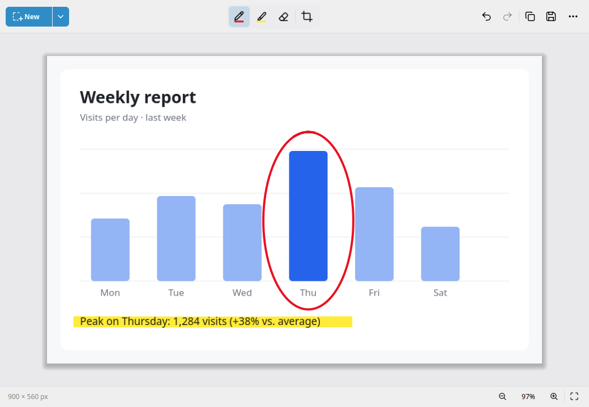
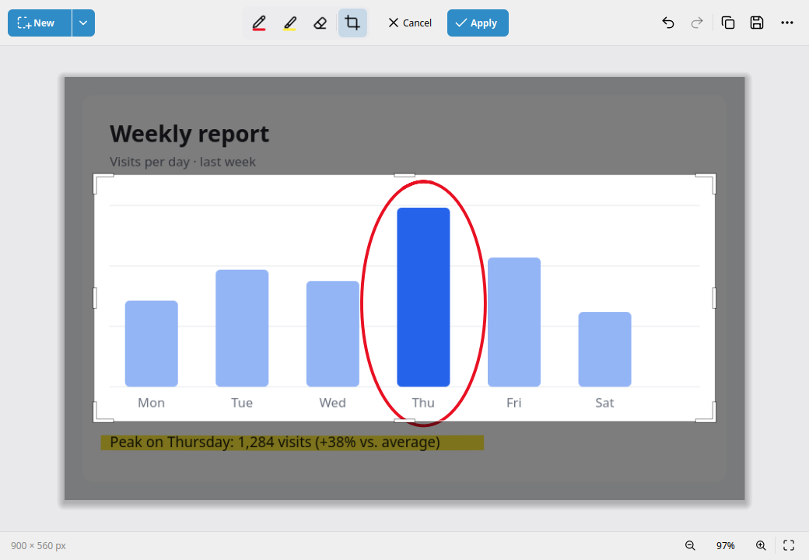
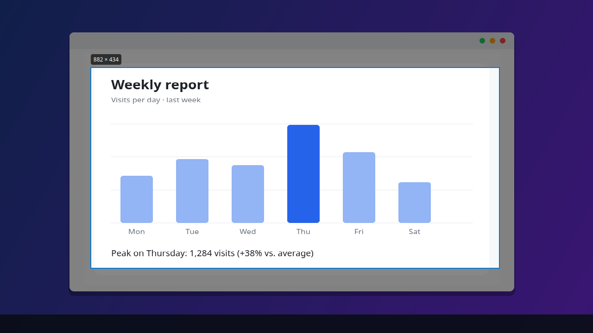
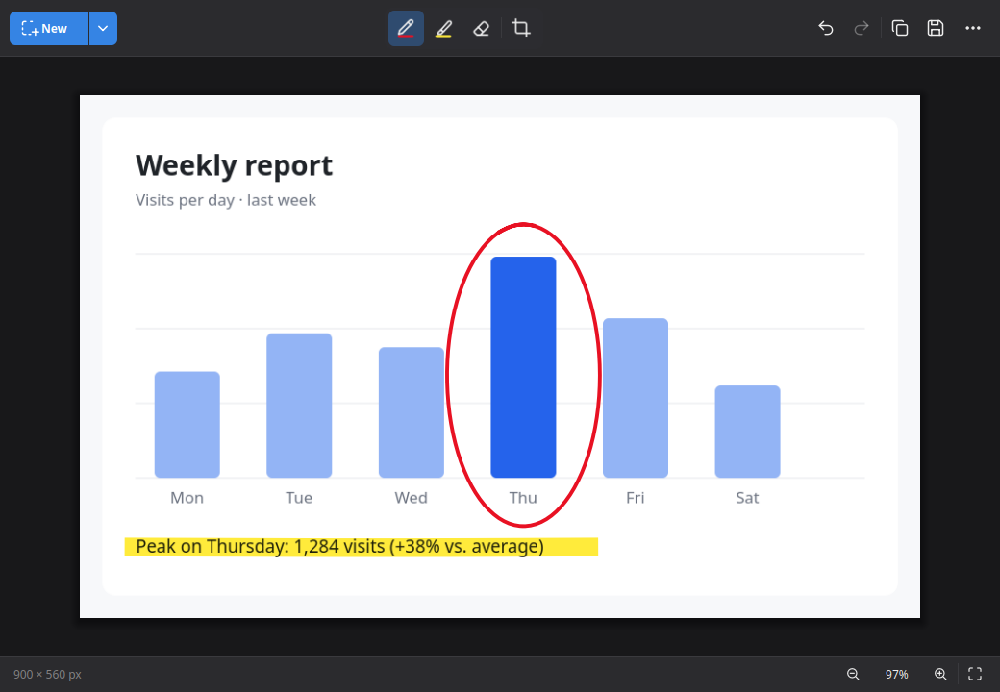

# Snip & Sketch for Linux

The Windows Snip & Sketch for Linux: press **Win+Shift+S**, pick an area, and it's on your clipboard. Click the notification to mark it up.



| Pick a window or drag an area | Crop, in light or dark |
|---|---|
|  |  |
|  |  |

## Install

Get the package from [Releases](https://github.com/hus201/linux-snip-and-sketch/releases):

```bash
sudo apt install ./snip-and-sketch_1.0.0_amd64.deb         # Ubuntu 22.04+, Mint 21+, Debian 12+
sudo dnf install ./snip-and-sketch-1.0.0-1.fc43.x86_64.rpm  # Fedora 43+
```

Win+Shift+S is set up automatically on Cinnamon, GNOME, KDE, Xfce, MATE, LXQt and COSMIC.

## Usage

- **Win+Shift+S** — snip to the clipboard
- `snip` — snip, then edit
- `snip --app` — open the editor (also in the app menu)
- `snip picture.png` — edit an image

In the editor: **P**en, **H**ighlighter, **E**raser, **C**rop. Click the active pen again for colours and sizes. Press **F1** for all shortcuts.

To change the hotkey: `snip-hotkey status | install | remove`.

Wayland support is experimental.

## Building

See [docs/development.md](docs/development.md).

## License

[MIT](LICENSE). Not affiliated with Microsoft.
