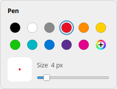

# Snip & Sketch for Linux

A clone of the Windows **Snip & Sketch / Snipping Tool**: press **Win+Shift+S**,
pick an area, and the snip is on your clipboard. Click the notification to mark
it up with a pen, highlighter, eraser and crop tool, then save or copy it.

Native C++/Qt 6 app for X11 desktops. Wayland support is built in but still experimental.


## Screenshots

| Win+Shift+S: pick a window… | …or drag any area |
|---|---|
|  |  |

| Crop with handles | Follows your dark theme |
|---|---|
|  |  |



**Ink palette:** click the active pen or highlighter again to choose a colour and size. Your choices are remembered.

<br clear="right">

## Install

Download from the [Releases](https://github.com/hus201/linux-snip-and-sketch/releases) page:

`snip-and-sketch_<version>_amd64.deb` works on Ubuntu 22.04+, Linux Mint 21+, Debian 12+, Pop!_OS, Zorin, elementary and similar distros:

```bash
sudo apt install ./snip-and-sketch_1.0.0_amd64.deb
```

The package sets up **Shift+Super+S** for you, both for the user installing it
and for everyone else at their next login.

On Fedora or openSUSE, build an RPM yourself; see [RPM](#rpm) below.

## Usage

| | |
|---|---|
| **Win+Shift+S** | Snip → clipboard → notification (click it to edit) |
| `snip` | Snip, then open the editor |
| `snip --app` | Open the editor (also in the app menu) |
| `snip --mode free\|rect\|window\|full` | Pick the snip mode (default: last used) |
| `snip --delay 3` | Snip after 3 seconds |
| `snip picture.png` | Open an image in the editor |

**Selection screen:** use the toolbar to switch between Rectangle, Freeform, Window and Fullscreen. Esc or right-click cancels.

**Editor:**
- **Ink:** click the active pen or highlighter again to open its colour and size palette. Your choices are remembered.
- **Crop:** drag the corner or edge handles, or drag inside to move the selection. Then press **Apply** (or Enter, or double-click).
- **Expand canvas** (⋯ menu, off by default): drawing past the edge of the snip grows it with white space. One undo removes the ink and the extra space together.
- **Light and dark:** the editor follows your desktop's theme.

| Key | Action |
|---|---|
| P / H / E / C | Pen, highlighter, eraser, crop |
| Enter / Esc | Apply / cancel a crop |
| Ctrl+Z / Ctrl+Y | Undo / redo |
| Ctrl+C | Copy |
| Ctrl+S | Save |
| Ctrl+N | New snip |
| Ctrl+O | Open an image |
| Ctrl+wheel, Ctrl+= / Ctrl+- | Zoom (around the cursor) |
| Ctrl+0 / Ctrl+9 | Actual size / fit to window |
| Space+drag, middle-drag | Pan |
| F1 | All shortcuts |

Snips are saved to `~/Pictures/Screenshots` by default.

## The hotkey on each desktop

`snip-hotkey` (installed with the `.deb`) manages the shortcut:

```bash
snip-hotkey status
snip-hotkey install            # add or repair Shift+Super+S
snip-hotkey remove
snip-hotkey install --force    # take over Shift+Super+S from another action
```

| Desktop | How it's set | Takes effect |
|---|---|---|
| Cinnamon (Linux Mint) | gsettings `org.cinnamon.desktop.keybindings` | immediately |
| GNOME, Ubuntu, Budgie, Pantheon, Unity | gsettings `media-keys custom-keybindings` | immediately |
| KDE Plasma 5 / 6 | `kglobalshortcutsrc` + `snip-and-sketch-new.desktop` | after logging out and back in |
| Xfce | `xfconf` `xfce4-keyboard-shortcuts` | immediately |
| MATE | dconf `/org/mate/desktop/keybindings/` | immediately |
| LXQt | `~/.config/lxqt/globalkeyshortcuts.conf` | immediately (restarts the key daemon) |
| COSMIC | `~/.config/cosmic/…Shortcuts/v1/custom` | immediately |
| sway, i3, Hyprland, Openbox | prints the line to add to your config | — |

Behaviour:
- **Conflicts:** if another action already uses Shift+Super+S, the script stops and tells you which one. Use `--force` to add the hotkey anyway.
- **Autostart:** the login entry (`/etc/xdg/autostart/snip-and-sketch-hotkey.desktop`) runs only once per user. If you change or remove the hotkey, it won't come back.
- **Uninstalling** the `.deb` or `.rpm` removes the hotkey for logged-in users.

## Notes

- **Wayland (experimental, untested so far):** the screen is captured through `xdg-desktop-portal`, and GNOME may ask permission the first time. Window snip is X11-only, because Wayland doesn't let apps list other windows.
- **Clipboard:** after a snip, the app keeps running in the background until something else is copied. Without that, the snip would vanish from the clipboard on desktops that have no clipboard manager.
- **Single instance:** pressing the hotkey while a snip is already open just brings that snip back to the front.

## Build from source

```bash
sudo apt install cmake ninja-build g++ qt6-base-dev qt6-base-dev-tools libqt6svg6-dev libgl1-mesa-dev
cmake -S . -B build -G Ninja -DCMAKE_INSTALL_PREFIX=/usr
cmake --build build
cd build && cpack -G DEB         # → snip-and-sketch_<version>_amd64.deb
```

### RPM

Releases ship only the `.deb` for now. The spec, `packaging/rpm/snip-and-sketch.spec`, lets you build an RPM yourself for Fedora or openSUSE (it also works for COPR / OBS):

```bash
packaging/rpm/build-rpm.sh                              # on Fedora/openSUSE (needs rpmbuild)
packaging/rpm/build-in-container.sh                     # from any distro with Docker/Podman
packaging/rpm/build-in-container.sh opensuse/tumbleweed
```

The container build also installs the RPM in a clean system and checks it runs. Results go to `dist/`.

## Tests

```bash
ctest --test-dir build --output-on-failure
```

| Suite | What it covers |
|---|---|
| `canvas` | Pen, highlighter, eraser (incl. fast swipes), crop handles/move/cancel, expand canvas, zoom mapping, HiDPI |
| `overlay` | Rectangle/freeform/window snips, cancelling, clipping to the screen, mode buttons, HiDPI |
| `editor` | Toolbar states, crop mode, ink palette, remembered settings, clipboard copy, opening files |
| `launch` | Single-instance messages, multi-monitor stitching |
| `hotkey` | `snip-hotkey` on Cinnamon, GNOME, MATE, Xfce, KDE 5/6, LXQt, COSMIC, tiling WMs |
| `packaging` | RPM spec and `.deb` scripts in sync with what the build installs (version, file list, helper paths) |

Tests don't touch your real setup:
- **No display needed:** the Qt suites run off-screen.
- **Settings stay safe:** the editor suite uses a temporary settings folder.
- **Desktop shortcuts stay safe:** the hotkey suite runs in its own D-Bus session with a temporary home folder. It checks its writes land there before doing anything, and stops if they don't.

Handy variations:

```bash
ctest --test-dir build -L unit                          # only the Qt suites
tests/hotkey/test_hotkey.sh cinnamon gnome              # only some desktops
build/test_canvas eraserHitsWhatWasDrawn                # a single test
tests/update-screenshots.sh build                       # regenerate docs/screenshots/
```

`update-screenshots.sh` renders the README screenshots from a built-in demo desktop and report, never your real screen. Run it after UI changes so the docs stay current.

**Fixing a bug?** Add a test that fails without the fix first. Several existing tests guard real bugs found this way:
- eraser missing corners
- eraser skipping strokes on fast swipes
- Cinnamon not reloading the hotkey
- disabled icons not dimming

## Releasing

CI (`.github/workflows/build.yml`) runs **only when a `v*` tag is pushed**. Ordinary commits and pull requests don't trigger it. On a tag it:
1. Builds on Ubuntu 22.04 (Qt 6.2), so the `.deb` installs on 22.04 and newer.
2. Runs all the tests.
3. Builds the `.deb` and publishes it as a GitHub Release.

To publish a release:
1. Bump `VERSION` in `CMakeLists.txt`.
2. Bump `Version` in the spec and add a `%changelog` entry. The `packaging` test fails if you forget.
3. Tag and push:

```bash
git tag v1.0.0 && git push origin v1.0.0
```

If any test fails, nothing is published.

## License

[MIT](LICENSE) © 2026 Snip & Sketch for Linux contributors.

"Snip & Sketch" and "Snipping Tool" are names of Microsoft products. This independent open-source project is not affiliated with or endorsed by Microsoft.
